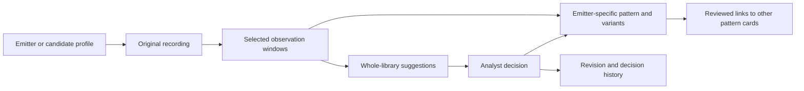

# Stage 0: coordinated emitter agility

Version: **0.1.6-preview.2.0**. Planning baseline: `d0eca9d` on `feature/revised-inputs`. Stage 0 delivers the implementation specification, executable draft recording contracts and controlled development dataset. The existing cycle atlas remains the running application; the emitter directory, event-table UI, new matcher and IndexedDB integration are subsequent stages. This preview is prepared locally, without GitHub publication.

Historical specification: stages 1–5 are now implemented in **preview 2.5**. The [implementation guide](agility-library.md) records the actual two-store database, provisional matching defaults, merge/undo policy and validation limits. The plans below retain their stage 0 context.

## Purpose and boundaries

Build a visual directory of coordinated agility across parameters, accumulating each emitter's patterns, variants, evidence and uncertainties over time. The first usable release requires automatic whole-library suggestions, partial matches, Patterns/Emitters views, reviewed links and complete local backup/restore.

Input represents one emitter or one analyst-selected candidate stream. Mixed-emitter separation happens upstream. One analyst maintains the library on one device. Frequency, PRI and pulse width are the core demonstration; additional numeric channels with explicit units are supported by the contract. Finite sequences, steady behaviour, transitions and repeating patterns are admissible.

## Entities and ownership



| Entity | Identity and responsibility |
| --- | --- |
| Stream profile | Stable ID, emitter/candidate kind, reviewed/uncertain attribution, name and notes; never inferred from a shape match |
| Recording | Immutable original payload, channel definitions, timestamp basis, recording/stream IDs and source provenance; capture ID is supplied or explicitly unknown |
| Observation window | Stable ID, recording ID and source-event bounds; references original events rather than copying them |
| Pattern | Stable emitter-specific ID, name, current revision, representative window, evidence associations and variants |
| Variant | Pattern-owned description of reviewed scale/range/duration differences, backed by observation windows |
| Evidence association | Links a window to a pattern revision and scopes support to specific measured channels and intervals; includes rationale and decision ID |
| Suggestion | Recomputable candidate, shared alignment, matched intervals, parameter explanations, limitations, matcher/settings versions and input fingerprint |
| Reviewed relationship | Stable link between two distinct pattern IDs; kind, reviewed intervals/channels, decision ID and revision |
| Decision/revision | Append-only change record with explanation and affected entity versions; undo adds a reversal rather than deleting history |

Separate emitter-specific cards are retained even for equivalent behaviour. A cross-emitter acceptance creates or links a card in the current emitter's repertoire and a reviewed relationship to the other card. It never transfers emitter attribution or another emitter's measured ranges. Relationships are not transitively confirmed: A–B and B–C do not automatically establish A–C.

The draft types and recording validator are in [spec/agility.ts](../spec/agility.ts). Types are contracts for subsequent implementation; declaring a type does not implement the associated storage or UI.

## Recording format and numerical semantics

The canonical interchange object is `EventRecording`, schema version 1:

```json
{
  "schemaVersion": 1,
  "id": "recording-01",
  "name": "Selected stream observation",
  "streamId": "candidate-01",
  "captureId": null,
  "time": { "unit": "us", "basis": "relative" },
  "channels": [
    { "id": "frequency", "name": "Frequency", "quantity": "frequency", "unit": "MHz", "origin": "supplied" },
    { "id": "pri", "name": "PRI", "quantity": "pri", "unit": "us", "origin": "supplied", "priConvention": "preceding-event" },
    { "id": "pulseWidth", "name": "Pulse width", "quantity": "pulse-width", "unit": "us", "origin": "supplied" }
  ],
  "events": [
    { "t": 0, "values": { "frequency": 100, "pri": null, "pulseWidth": 0.8 } },
    { "t": 8, "values": { "frequency": 120, "pri": 8, "pulseWidth": null } }
  ],
  "provenance": { "source": "measured", "file": "capture.csv" }
}
```

This abbreviated two-row example illustrates fields; it intentionally does not meet the 16-measurement import gate. Full qualifying examples are in [the control dataset](../datasets/agility-stage0-v1/README.md).

- Timestamps are finite and strictly increasing. The timestamp is the event's time of arrival. Relative time may start at any offset. Absolute time needs an explicit origin; store offsets instead of large absolute floating-point epoch values.
- Time units are `s`, `ms`, `us`, `ns` or arbitrary `tu`; Frequency units are `Hz`, `kHz`, `MHz`, `GHz` or arbitrary `fu`. PRI and pulse-width channels use time units. Convert compatible physical units explicitly in derived comparison views; do not infer physical conversions for arbitrary units.
- PRI is associated with the event ending the preceding interval. The first PRI may be missing or supplied from prior capture context. Imported alternative conventions require an explicit, previewed conversion before canonical storage; do not silently shift the channel.
- Supplied PRI remains supplied evidence even when it differs from adjacent timestamp spacing. Missing detections, upstream processing and measurement conventions can cause differences. Show discrepancies; do not rewrite measurements.
- PRI derivation is deferred. Future derivation from adjacent timestamps requires an explicit choice and evidence of consecutive events, with formula, assumptions and missing-detection limitations recorded. Derived values do not count toward the supplied-measurement gate or independent capture support.
- Each event represents every declared channel with a finite number or `null`. Blank CSV cells mean `null`; zero is a value. PRI and pulse width must be positive when present. Channel IDs are unique; arbitrary numeric channel units must be explicit and have declared compatibility before conversion.
- JSON is the canonical complete representation. Controlled CSVs put recording/channel metadata in a `# recording: {...}` comment, followed by `t,<channel IDs>` and numeric rows. The future CSV intake can map ordinary column headers and collect missing metadata in a preview before producing this object.
- Preserve source bytes alongside the canonical representation. Conversion, normalization, interpolation, resampling and display simplification are derived operations with recorded provenance; they never overwrite originals.

No multi-parameter coordination is invented by combining unrelated legacy Frequency and PRI entries, matching IDs, or equal sample counts.

## Import gate, windows and evidence

A recording needs at least 16 events spanning finite nonzero time and at least one supplied channel containing 16 finite measurements. Missing/derived values do not satisfy that minimum. Require recording/stream IDs, channel units and provenance; capture identity can remain explicitly unknown. The draft validator has a provisional 100,000-event ceiling, not a demonstrated application capacity.

The default window covers all source events. Bounds use **event indices `[startEvent, endEvent)`**, including the last selected event and excluding the event at `endEvent`. This convention avoids dropping the final event through an ambiguous time-bound comparison. Display the timestamps of the first and last included events and preserve both index bounds and source identity.

Additional windows reference the same source; overlapping windows are related evidence. A short window can remain visible for inspection, but matching requires the same 16-event/measurement gate. Periodic cycle extraction remains a distinct derived operation and retains its legacy guards.

Report per-channel supplied counts, pairwise simultaneous counts, time coverage and gaps. A multi-parameter relationship requires sufficient common evidence in at least two channels, covering the actual aligned interval. Two disjoint channels cannot establish their coordination. A missing channel neither confirms nor contradicts the match; unseen ends of a partial match remain unsupported.

The exact overlapping coverage and minimum partial-match length remain development settings to reassess when the app is rebuilt. Stage 0 reports counts and intervals without selecting a similarity cutoff or claiming adequacy from row count alone.

## Review lifecycle and relationship semantics

| State/action | Result |
| --- | --- |
| Valid import | Create full-recording unreviewed window immediately; schedule provisional grouping/suggestions |
| Pending/running matching | Keep the observation visible, with progress/cancellation; do not fabricate dashed links before candidates exist |
| Complete matching | Show ranked candidates and explained dashed links; weak, single-parameter and partial results remain labelled |
| Support existing pattern | Add a scoped association and revision within the current emitter's repertoire |
| Accept variant | Add a reviewed variant, retaining absolute values, original timing and evidence |
| Accept cross-emitter relation | Retain two emitter-specific cards; create a solid labelled link with two evidence scopes |
| Create new pattern | Create a stable card and first reviewed evidence association |
| Leave unresolved | Retain the source/window and provisional state; permit later review |
| Challenge interpretation | Append explanation/new evidence; preserve the earlier revision for inspection |
| Reject/undo | Record rejection or a reversal; preserve originals and the audit trail |

Solid relationship kinds initially include coordinated similarity, scale variant and partial match. Labels and evidence scopes govern their meaning. A solid partial-channel link cannot be presented as full-pattern confirmation. Explicit decisions persist as the collection grows. New metrics or evidence can mark a decision for reassessment, but cannot silently remove or rename its card/link.

Automatically recomputed groups are exploration aids, separate from pattern identity and reviewed relationships. Complete linkage is a possible grouping view, not a requirement for the new matcher or proof of emitter identity. Numerical map distance is not advertised as similarity.

## Matching and background-work contract

1. Validate the selected source interval and gather only eligible, unit-compatible evidence. Carry missing-data masks through every operation.
2. Retrieve candidates from all stored patterns. Later indexing is a shortlist optimization; compare recall with an exact scan on the controls.
3. Align synchronized channels together. Preserve order and allow a single global time offset/positive scale. Circular alignment is allowed only for explicitly supported repeating behaviour; finite sequences cannot wrap across their ends. No independent per-channel phase shift, reversal or unrestricted local time warping.
4. Search contiguous target subintervals for partial matches. Record query and target bounds plus shared alignment. Explain ambiguous intervals, such as repeated motifs; do not force one unique interval without evidence.
5. Rank coordinated shape/order/timing first, with separately visible absolute-range and duration terms and adjustable weights. Report per-channel agreement, conflict, missingness and overlapping coverage. Constant channels need an explicit non-dividing comparison path; steady values cannot create NaN or artificial shape certainty.
6. Return bounded ranked suggestions with limitations and the actions to associate, create or remain unresolved. No result automatically changes reviewed memberships or emitter attribution.

Worker requests carry request ID, recording/window fingerprint, collection revision, matcher version and settings hash. Publish only results matching the current request and revisions. Cancellation, changing a window and updating the collection invalidate prior results. Errors leave stored observations and decisions intact. Feature caches are derived, versioned and discardable.

**Tuning is deferred until the application is rebuilt**, as requested. Stage 0 defines invariants and adversarial cases; it does not freeze channel weights, score thresholds, overlap cutoffs or partial lengths. The existing 65% threshold and 70/30 formula/vision blend remain part of the old cycle atlas and are not a validated default for coordinated event data. Parameter tuning should use development data followed by independent source-separated validation.

## Directory interactions

Patterns and Emitters are views over the same library. Pattern cards show compact multi-parameter previews, emitter identity/status, review status and channel coverage. Emitter profiles show their repertoire, variants, observation timeline, evidence and unresolved questions.

Selecting a card opens aligned plots with shared cursor, interval selection and zoom. Original/normalized comparisons must retain the selected interpretation in labels. Joint-parameter plots and sequence/dwell views complement the shared timeline. Mark missing values and modelled gaps rather than drawing an observed continuous trace through them.

Selection reveals related cards and dashed/solid labelled links. Show links expands the visible relationships; filtering and viewport rendering limit clutter. Clicking a line opens its comparison and source evidence. Provide a keyboard-accessible relationship list and filters alongside lines. Respect reduced motion and preserve browsing state.

## IndexedDB, migration and backup plan

Proposed database: `signal-atlas-agility`, version 1. Stores: streams, recordings, windows, patterns, variants, evidence associations, relationships, decisions/revisions, settings and disposable feature caches. Index by owning stream, recording/window, pattern endpoints, capture ID and revision. Windows reference originals; source deletion must preview dependent evidence and offer explicit archival/removal behavior.

One transaction commits each import or review operation with all affected entities and its decision record. Storage failure leaves the prior state intact. Preserve supplied IDs or map conflicts explicitly; exact duplicate payloads and repeated/overlapping windows do not constitute independent support. Unknown capture IDs do not become independent acquisitions by using filenames or generated recording IDs.

| Legacy browser key | Migration behavior |
| --- | --- |
| `frequency-agile-atlas.imports.v1` | Preserve complete-cycle entries and original scale; import as legacy single-channel evidence awaiting explicit emitter/candidate association |
| `frequency-agile-atlas.measured.v1` | Preserve originals, extracted-window bounds, capture provenance, reconstruction assumptions and source-linked decisions |
| `frequency-agile-atlas.grouping.v2` | Retain scoped historical settings/calibration for recovery; do not apply them to new multi-parameter ranking |
| `frequency-agile-atlas.group-review.v1` | Preserve historical group decisions and undo snapshots as legacy history |
| `frequency-agile-atlas.library-review.v1` | Preserve reviewed IDs/names and history as legacy reviewed group structures; pattern associations require explicit mapping/review |

Preview migration and persist its ID mapping atomically. Leave old keys untouched until the analyst has verified migration and backup. Invalid legacy data remain recoverable; unresolved mappings do not become invented emitter identities or synchronized observations.

Backup is a versioned manifest plus source payloads and all durable entities/settings/history, with SHA-256 integrity references. Restore validates all files/references/schema before switching the active library. Replace through a validated temporary database; merge previews duplicate IDs, source payloads and relationship conflicts. Failed validation leaves the current library intact. Historical decisions retain their original context even if the current matcher cannot reproduce them. A bounded quick-undo interface does not truncate the portable audit history.

## Controlled dataset and evaluation rules

[Agility Stage 0 v1](../datasets/agility-stage0-v1/README.md) contains 15 valid synchronized recordings in JSON/CSV, 17 source windows, 11 relationship cases and 9 rejection controls. It includes equivalent cross-emitter/unit-converted observations, a global scale variant, changed coordination, a contiguous middle capture, missing and disjoint channels, steady values, unfamiliar behaviour, a duplicate capture, a 16-event boundary, repetition, perturbations and an extra numeric channel.

Expected relationships are separate manifest labels describing construction. They are not matcher outputs, scores or physical classes, and must not be passed into ranking. The cases are development controls, not an independent accuracy benchmark. Related constructions/captures/windows share source-group lineage; never split them across tuning and evaluation. Use fresh source-separated synthetic and measured examples for later assessment.

Stage 0 checks schema behavior, preservation, serialization, hashes, source bounds, joint evidence, coordination adversaries and deterministic reproduction. It does not test an unimplemented matcher or claim successful automatic ranking, reviewed UI flows, database restore, measured accuracy or pilot-scale browsing.

## Capacity and benchmark protocol

Targets: at most 100,000 events in a recording, 1 million retained source events, about 50 emitter/candidate profiles and **500 selected observation windows**, including defaults. Multiple windows reference one stored source; count retained events once. `pnpm controls:pilot` generates an ignored capacity workload with these exact counts; it is not an app benchmark.

After the rebuild, record hardware/browser versions and compare desktop plus a constrained mobile-class device. Exercise largest-file import/preview, full-library browsing, view toggles, selection, shared zoom, full/partial matching, cancellation, changed-window results, quota failure, migration and full restore. Log percentile interaction latency, first-visible-data time, worker duration, memory, stored bytes and restore integrity.

Initial budgets for measurement are p95 interaction latency below 100 ms, first visible decimated plots within 2 seconds after source availability, and background matching with progress visible within 200 ms. These are proposed engineering goals to reassess on the rebuilt application, not measured claims. Establish ranking completion and memory budgets from the exact baseline before indexing. Rendering simplification must preserve jumps/gap boundaries and cannot alter exported evidence.

## Stage 0 completion and stage 1 handoff

Completion requires reproducible fixtures with verified hashes, a passing recording-contract/control suite, a type-checked local production build tagged `v0.1.6-preview.2.0`, and a roadmap that separates stage 0 artifacts from future functionality. No GitHub push, release or deployment is part of this stage.

Stage 1 starts with IndexedDB stores/transactions, event-table JSON/CSV preview/import, explicit emitter/candidate association, originals/full/narrowed windows, migration recovery and complete backup/restore. Build this against the contracts and controls here. Stages 2–4 add the new directory, matcher and review interactions. Automatic whole-library and partial suggestions remain mandatory for the first usable release.

[Roadmap](../ROADMAP.md) · [Control dataset](../datasets/agility-stage0-v1/README.md) · [Current recording workflow](recordings.md) · [Verification](../VERIFICATION.md)
